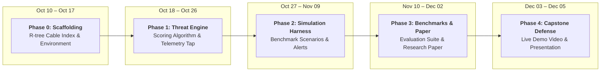

<div align="center">

# 🛡️ Aegis-Sea

### Real-Time Subsea Cable Threat Monitoring & Automated Incident Response

[](LICENSE)
[](https://www.python.org/)
[](https://nodejs.org/)
[](https://cesium.com/)
[](https://github.com/bilawalsidhu/gods-eye-view)

**Protecting the physical backbone of the global internet by detecting maritime threats to undersea cables *before* physical damage happens.**

---

*Fordham University · Department of Computer and Information Sciences*  
*CISC 6090: Capstone in Cybersecurity*

**Author:** Rayed Jawad · [rjawad1@fordham.edu](mailto:rjawad1@fordham.edu)  
**Project Advisor:** Dr. Juntao Chen  
**Course Instructor:** Dr. Thaier Hayajneh  
**Upstream Foundation:** [God's Eye View](https://github.com/bilawalsidhu/gods-eye-view) by [Bilawal Sidhu](https://github.com/bilawalsidhu)

</div>

---

## 🌊 Overview

Over **95% of all intercontinental internet traffic** and more than **$10 trillion in daily financial transactions** travel through a network of fiber-optic cables resting on the ocean floor. Despite their critical importance, these cables are only about the thickness of a garden hose and lie mostly unmonitored in international waters.

Recent incidents in the Baltic Sea and Red Sea have shown how vulnerable this infrastructure is: commercial vessels dragging their anchors along the seabed can quietly sever multiple undersea cables across hundreds of miles. 

Today, network operators only discover a cable is broken **after it has already been cut**. Repair ships take weeks to deploy, costing millions of dollars and causing widespread communication disruptions.

**Aegis-Sea** solves this blind spot by actively monitoring live global ship movements in 3D and alerting security teams to suspicious behavior—such as anchor dragging, lingering, or ships turning off their trackers—**before a cable is severed**, giving network operators enough time to safely reroute internet traffic.

---

## ⚙️ How It Works

Aegis-Sea continuously correlates live maritime vessel telemetry with the global network of undersea cables through four main steps:

```
┌─────────────────────────┐       ┌─────────────────────────┐       ┌─────────────────────────┐       ┌─────────────────────────┐
│  1. Map Undersea Cables │       │  2. Define Watch Zones  │       │ 3. Score Ship Behavior  │       │  4. Automated Response  │
│                         │  ──►  │                         │  ──►  │                         │  ──►  │                         │
│  Index all 712 global   │       │  9 NM Alert Corridor    │       │  Evaluate distance,     │       │  Send webhook alerts    │
│  cables for sub-        │       │  3 NM Cable Protection  │       │  slow dragging speed,   │       │  and simulate pre-cut   │
│  millisecond lookup     │       │  Zone around each cable │       │  loitering & dark ships │       │  traffic rerouting      │
└─────────────────────────┘       └─────────────────────────┘       └─────────────────────────┘       └─────────────────────────┘
```

### 1. High-Speed Cable Mapping
Using data from TeleGeography, Aegis-Sea indexes all **712 active submarine cable systems** (broken into nearly 12,000 geographic segments). A spatial index allows the system to check thousands of active ships against every cable in under a millisecond.

### 2. Dual Watch Corridors
Around every undersea cable line, Aegis-Sea establishes two safety zones:
- **Alert Corridor (9 Nautical Miles):** An outer advisory zone where nearby vessel courses and speeds are actively tracked.
- **Cable Protection Zone (3 Nautical Miles):** An inner restricted zone modeled after international cable protection standards, where dragging anchors or stopping is considered a serious hazard.

### 3. Suspicious Behavior Evaluation
Rather than sounding the alarm for every passing ship, Aegis-Sea looks for a combination of real-world warning signs:
- **Proximity:** How close the vessel is to the cable line.
- **Abnormal Speed:** Merchant ships normally cruise at 12–24 knots. If a ship slows down to 1–3.5 knots while continuing under power, it matches the signature of dragging an anchor.
- **Loitering:** A ship lingering or station-keeping directly above a cable corridor.
- **Course Alignment:** Whether the ship is running parallel directly along the cable trench or heading straight across it.
- **Sudden Braking:** A sharp drop in speed inside the protection zone, indicating an anchor catch.
- **Dark Vessels:** Vessels that turn off their public tracking signal (AIS transponder) while near a cable.

### 4. Automated Early Warning & Traffic Rerouting
Threat levels are categorized into four intuitive stages:

| Level | Status | Meaning | What Happens |
| :---: | :---: | :--- | :--- |
| 🟢 | **Normal** | Standard transit | Monitored in the background; no alarms. |
| 🟡 | **Advisory** | Ship entering corridor or moving slowly | Highlighted on the 3D globe; tracking frequency increases. |
| 🟠 | **High Alert** | Suspicious maneuver or loitering near cable | Automated alert sent to security operations teams. |
| 🔴 | **Critical** | Anchor drop or imminent severance detected | Emergency webhook triggered; simulates rerouting internet traffic to backup routes before the cable snaps. |

---

## 🖥️ System Architecture

Aegis-Sea combines a rich interactive 3D frontend with a fast, isolated Python threat-detection backend:

```
┌────────────────────────────────────────────────────────────────────────┐
│                        GOD'S EYE VIEW (FRONTEND)                       │
│   • 3D CesiumJS photorealistic globe running in your browser           │
│   • Displays live ships, 712 subsea cables, and threat zones           │
│   • Interactive tactical dashboard for security operators              │
└───────────────────────────────────┬────────────────────────────────────┘
                                    │  Polls /api/vessels
                                    ▼
┌────────────────────────────────────────────────────────────────────────┐
│                        AEGIS-ENGINE (PYTHON BACKEND)                   │
│   • High-speed spatial index (sub-millisecond distance checks)         │
│   • Continuous threat scoring engine                                   │
│   • Automated alert webhook dispatcher                                 │
└───────────────────────────────────┬────────────────────────────────────┘
                                    │  Dispatches alerts
                                    ▼
┌────────────────────────────────────────────────────────────────────────┐
│                      AUTOMATED INCIDENT RESPONSE                       │
│   • Webhook alerts to security operations centers (SOC)                │
│   • Simulated Software-Defined Network (SDN) pre-cut failover          │
└────────────────────────────────────────────────────────────────────────┘
```

---

## 🗺️ Project Roadmap & Milestones

Designed for execution across the Fall 2026 academic semester:



| Phase | Time Horizon | Status | Key Focus & Technical Deliverables | Academic Milestone |
| :---: | :---: | :---: | :--- | :---: |
| **Phase 0** | **Oct 10 – Oct 17** | ✅ **Complete** | Environment setup, R-tree cable indexing (`shapely`/`rtree`), literature review | **Related Work (Oct 17)** |
| **Phase 1** | **Oct 18 – Oct 26** | 🟡 **In Progress** | 6-factor composite scoring engine, `/api/vessels` polling tap, Cesium threat HUD | *Core Engine Verification* |
| **Phase 2** | **Oct 27 – Nov 09** | ⏳ Upcoming | Deterministic simulation harness, benchmark scenarios, SOAR webhook dispatcher | **Progress Report (Oct 31)** |
| **Phase 3** | **Nov 10 – Dec 02** | ⏳ Upcoming | Automated benchmark runs, ROC/PR curves, complete research paper | **Draft Report (Dec 03)** |
| **Phase 4** | **Dec 03 – Dec 05** | ⏳ Upcoming | High-definition video demo, defense slide deck | **Final Presentation (Dec 05)** |

### Phase 0: Scaffolding & Geospatial Indexing `Oct 10 – Oct 17`
- [x] Establish and verify local God's Eye View runtime (Node.js 24 LTS + Vite + Cesium).
- [x] Inspect and document live AISStream WebSocket and TeleGeography cable layers.
- [x] Initialize Python environment (`aegis-engine/`) with `shapely`, `rtree`, `fastapi`, and `pydantic`.
- [x] Build `CableCorridorIndex` with R-tree spatial indexing over all 712 subsea cable geometries.
- [x] Compile reference literature library (15 academic papers) and mapping matrix.
- [ ] Finalize and submit the **Related Work** literature review document.

### Phase 1: Threat Scoring Core & API Ingestion `Oct 18 – Oct 26` *(Current Phase)*
- [ ] Build `AISPoller` client polling `/api/vessels` and caching kinematic states in `VesselState`.
- [ ] Implement mathematical formulations for all 6 scoring factors in `aegis.scorer`.
- [ ] Construct FastAPI service exposing `GET /api/threats` and `GET /api/threats/{mmsi}`.
- [ ] Integrate Node.js reverse proxy (`server/providers/aegis.js`) and Cesium frontend threat layer.

### Phase 2: Simulation Harness & Automated Response `Oct 27 – Nov 9`
- [ ] Develop deterministic simulation engine (`aegis.simulation.harness`).
- [ ] Author JSON scenario configurations for all benchmark scenarios (including *Yi Peng 3*).
- [ ] Implement `AlertDispatcher` with SOAR JSON webhook emission.
- [ ] Build standalone mock webhook receiver and incident log audit recorder.
- [ ] Complete and submit the **Progress Report** (due Oct 31).

### Phase 3: Empirical Benchmarking & Research Paper Authoring `Nov 10 – Dec 3`
- [ ] Execute automated benchmark runs across scenarios and naive baselines.
- [ ] Generate all evaluation charts, confusion matrices, and ROC curves using `matplotlib` / `seaborn`.
- [ ] Author the complete research paper.
- [ ] Format and compile final document with all figures and academic citations.
- [ ] Submit final **Draft Report** (due Dec 3).

### Phase 4: Final Demonstration & Presentation `Dec 3 – Dec 5`
- [ ] Record a high-definition screencast demonstration of an anchor-drag incident triggering SDN rerouting.
- [ ] Prepare slide presentation covering threat landscape, architecture, model, and metrics.
- [ ] Deliver **Final Capstone Defense & Presentation** (Dec 5).

---

## 🚀 Quick Start & Local Setup

### Prerequisites
- **Node.js:** Node 24 LTS (`>=24.14.0`) or Node 26
- **Python:** Python 3.10+
- **Git**

---

### 1. Start the 3D Map (Frontend)
```bash
# Clone the repository
git clone https://github.com/R4Y3D/aegis-sea.git
cd aegis-sea

# Install frontend dependencies
npm ci

# Start the local development server
npm run dev
```
Open **`http://localhost:4173`** in your browser. Toggle the **Vessels** and **Submarine Cables** layers in the display controls.

> **Optional:** To stream live worldwide vessel data, sign up for a free key at [aisstream.io](https://aisstream.io/) and create a `.env` file in the root directory:
> ```env
> AISSTREAM_API_KEY=your_api_key_here
> ```

---

### 2. Start the Threat Engine (Python Backend)
Open a new terminal window:
```bash
# Move to the engine folder
cd aegis-engine

# Create and activate a Python virtual environment
python -m venv .venv

# On Windows:
.venv\Scripts\Activate.ps1
# On macOS / Linux:
# source .venv/bin/activate

# Install requirements
pip install -r requirements.txt

# Run the automated tests to verify everything is working
pytest tests/
```

---

## 📁 Repository Structure

```
aegis-sea/
├── server/                   # Node.js backend & local development server
│   └── providers/
│       └── vessels/          # Live vessel streaming & cache
│
├── src/                      # Frontend client (CesiumJS 3D Globe)
│   ├── layers/
│   │   ├── vessels/          # Ship billboard markers & info cards
│   │   └── submarineCables/  # 3D undersea cable lines & landing points
│   └── data/local_data/      # GeoJSON cable dataset (TeleGeography)
│
├── aegis-engine/             # Dedicated Python Threat Detection Engine
│   ├── aegis/
│   │   ├── cable_index.py    # Spatial index for 712 subsea cables
│   │   ├── config.py         # System settings, zones & thresholds
│   │   └── models.py         # Data schemas
│   └── tests/                # Automated unit & performance test suite
│
├── docs/                     # Detailed project documentation & literature notes
└── PAPERS/                   # Reference academic research library
```

---

## 📚 Academic Research & Documentation

A formal research paper detailing the underlying algorithms, empirical test results, and comparative benchmarks is being authored as part of this capstone project. 

- For technical background on the academic research papers informing this project, see [`docs/LITERATURE_MAPPING.md`](docs/LITERATURE_MAPPING.md).
- Reference publications and monographs are archived in [`PAPERS/`](PAPERS/).

---

## 👏 Acknowledgments & Credits

- **[God's Eye View](https://github.com/bilawalsidhu/gods-eye-view)** by [Bilawal Sidhu](https://github.com/bilawalsidhu) — The open-source 3D spatial intelligence globe that serves as our visualization layer. Upstream documentation is preserved in [`docs/UPSTREAM_README.md`](docs/UPSTREAM_README.md).
- **[TeleGeography](https://www.submarinecablemap.com/)** — Comprehensive global submarine cable routes and landing station datasets.
- **[AISStream.io](https://aisstream.io/)** — Real-time worldwide Automatic Identification System telemetry.
- **[CesiumJS](https://cesium.com/)** — Open-source 3D geospatial rendering engine.
- **Dr. Juntao Chen** — Project Advisor, Assistant Professor, Department of Computer and Information Sciences & Fordham Center for Cybersecurity.
- **Dr. Thaier Hayajneh** — Course Instructor (CISC 6090: Capstone in Cybersecurity), University Professor & Director of the Fordham Center for Cybersecurity.

---

<div align="center">

**Fordham University · Department of Computer and Information Sciences · 2026**

</div>
