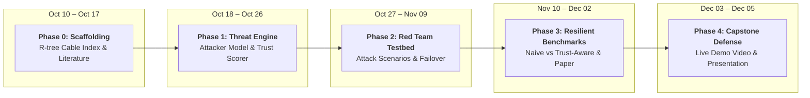

<div align="center">

# 🛡️ Aegis-Sea

### Resilient Cyber-Physical Defense & Automated Incident Response for Undersea Critical Infrastructure

[](LICENSE)
[](https://www.python.org/)
[](https://nodejs.org/)
[](https://cesium.com/)
[](https://github.com/bilawalsidhu/gods-eye-view)

**Defending the physical backbone of the global internet when the surveillance telemetry itself cannot be trusted.**

---

*Fordham University · Department of Computer and Information Sciences*  
*CISC 6090: Capstone in Cybersecurity*

**Author:** Rayed Jawad · [rjawad1@fordham.edu](mailto:rjawad1@fordham.edu)  
**Project Advisor:** Dr. Juntao Chen  
**Course Instructor:** Dr. Thaier Hayajneh  
**Upstream Foundation:** [God's Eye View](https://github.com/bilawalsidhu/gods-eye-view) by [Bilawal Sidhu](https://github.com/bilawalsidhu)

</div>

---

## 🌊 Overview

Over **95% of all intercontinental internet traffic** and more than **$10 trillion in daily financial transactions** travel through an underwater mesh of fiber-optic cables resting on the seabed. Despite their global criticality, these cables are often no thicker than an average garden hose and lie mostly unmonitored in international waters.

Recent gray-zone incidents in the Baltic and Red Seas—such as the *Newnew Polar Bear* (2023) and *Yi Peng 3* (2024) anchor-dragging cuts—have proven that commercial vessels can drag heavy anchors for over 100 miles, severing critical communication conduits under the guise of "accidental equipment failure."

### The Core Cybersecurity Problem
Existing commercial maritime monitors (e.g., Windward, Spire, MarineTraffic) treat Automatic Identification System (AIS) tracking data as honest ground truth. But maritime tracking operates over **unencrypted, unauthenticated radio frequencies** with zero cryptographic protection. 

An adversary attempting sabotage will not broadcast an honest signal saying they are dragging an anchor. Instead, they can turn off transponders, spoof false coordinates using cheap software-defined radios, or inject phantom "ghost ships" to distract operators.

**Aegis-Sea** asks a stronger cybersecurity question:  
> **How can we detect physical threats to undersea infrastructure and trigger automated network defense *when the adversary can actively manipulate, spoof, or weaponize the surveillance data we rely on?***

---

## ⚓ Why Undersea Security Is Unique

Securing undersea cables presents fundamentally different challenges than traditional land-based network security:

- **Deep Physical Inaccessibility:** Cables lie thousands of meters underwater. A severed line cannot simply be inspected or rebooted by an on-site technician; specialized repair ships take weeks or months to mobilize, costing millions in downtime.
- **Jurisdictional Void:** Under the UN Convention on the Law of the Sea (UNCLOS), coastal states have limited legal authority to intercept or board foreign-flagged commercial vessels in international waters or Exclusive Economic Zones (EEZs) before damage occurs. Defense must be proactive and automated at the network layer.
- **Extreme Asymmetry:** A $500 software radio and a commercial anchor can cut off communications for entire nations, while defending thousands of miles of seabed in real time requires autonomous intelligence.

---

## 🎯 Attacker Model & Threat Vectors

Aegis-Sea models an adversary capable of both physical sabotage and electronic/telemetry manipulation:

```
┌────────────────────────────────────────────────────────────────────────┐
│                        ADVERSARY CAPABILITY MODEL                      │
│                                                                        │
│   [ Physical Attack Vector ]           [ Cyber / Telemetry Vector ]    │
│   • Slow anchor-dragging (1–3.5 kn)    • Transponder blackout (dark)   │
│   • Intentional corridor loitering     • GPS / coordinate spoofing     │
│   • Perpendicular cutting intercept    • Ghost ship decoys (DoS)       │
└───────────────────────────────────┬────────────────────────────────────┘
                                    │
                                    ▼
┌────────────────────────────────────────────────────────────────────────┐
│                        AEGIS-SEA DEFENSE LAYER                         │
│   • High-speed R-tree spatial index over 712 global subsea cables      │
│   • Telemetry Trust Layer (jump filters & spoofing sanity checks)      │
│   • Continuous 6-factor kinematic anomaly scoring                      │
│   • Pre-emptive SDN BGP traffic evacuation before physical cut         │
└────────────────────────────────────────────────────────────────────────┘
```

1. **Transponder Blackouts ("Going Dark"):** A hostile vessel turns off its AIS transponder miles before reaching a cable corridor, attempting to disappear from monitoring screens. Aegis-Sea detects the sudden silence near sensitive infrastructure, projects a dead-reckoning course, and flags a blackout threat.
2. **Telemetry & GPS Spoofing:** Adversaries transmit falsified GPS positions or speeds to mask hostile maneuvers or make ships appear in benign locations. Aegis-Sea applies kinematic jump filters to detect physically impossible speed jumps.
3. **Ghost Ship Decoys (Denial of Service on Network Capacity):** Attackers inject fabricated AIS tracks of phantom ships dragging anchors across cables to trick operators into triggering emergency failovers—unnecessarily congesting backup networks. Aegis-Sea’s trust layer validates target authenticity before triggering failovers.

---

## ⚙️ How Aegis-Sea Works

Aegis-Sea correlates real-time maritime telemetry with global undersea cable geography through four steps:

### 1. High-Speed Cable Mapping
Using data from TeleGeography, Aegis-Sea indexes all **712 active submarine cable systems** (decomposed into nearly 12,000 geographic segments). A two-tier R-tree spatial index enables the system to check thousands of moving ships against every global cable in **under a millisecond (~0.012 ms)**.

### 2. Dual Watch Corridors
Around every undersea cable line, Aegis-Sea establishes two safety perimeters:
- **Alert Corridor (9 Nautical Miles):** An outer advisory zone where approaching vessel courses, speeds, and telemetry integrity are actively tracked.
- **Cable Protection Zone (3 Nautical Miles):** An inner restricted zone modeled after international cable protection standards, where dragging anchors or stopping is considered a critical hazard.

### 3. Trust-Aware Threat Scoring
Aegis-Sea evaluates vessel behavior across six continuous factors:
- **Proximity:** Quadratic distance decay toward the cable line.
- **Speed Anomaly:** Logistic sigmoid flagging abnormal anchor-dragging speeds (1.0–3.5 knots) vs. normal merchant transit (12–24 knots).
- **Loitering:** Dwell time spent lingering directly inside the cable corridor.
- **Heading Alignment:** Whether a vessel is tracking parallel along the cable trench or cutting across it.
- **Anchor Catch Signature:** Sharp deceleration inside the protection zone while maintaining propulsion.
- **Telemetry Trust / Blackout:** Penalizing transponder silence or erratic coordinate jumps.

### 4. Automated Incident Response
Threat scores scale from 0 to 100 across four operational tiers:

| Level | Badge | Meaning | System Action |
| :---: | :---: | :--- | :--- |
| 🟢 | **Normal** | Standard cruising transit | Monitored in background; no alarms. |
| 🟡 | **Advisory** | Entering corridor or moving slowly | Highlighted on 3D globe; polling rate doubled. |
| 🟠 | **High Alert** | Suspicious maneuver, loiter, or dark vessel | Automated webhook dispatched to security operations teams. |
| 🔴 | **Critical** | Anchor drop or imminent severance detected | Emergency webhook triggered; **simulates pre-emptive SDN BGP traffic drain** to backup links before the physical cable is cut. |

---

## 🖥️ System Architecture

Aegis-Sea combines an interactive 3D global visualization frontend with a fast, isolated Python threat engine:

```
┌────────────────────────────────────────────────────────────────────────┐
│                        GOD'S EYE VIEW (FRONTEND)                       │
│   • 3D CesiumJS photorealistic globe running in your browser           │
│   • Displays live ships, 712 subsea cables, and threat risk halos      │
│   • Interactive tactical dashboard for security operators              │
└───────────────────────────────────┬────────────────────────────────────┘
                                    │  Polls /api/vessels
                                    ▼
┌────────────────────────────────────────────────────────────────────────┐
│                        AEGIS-ENGINE (PYTHON BACKEND)                   │
│   • High-speed R-tree spatial index (< 0.02 ms distance lookups)       │
│   • Telemetry Trust Layer (filters spoofed jumps & flags dark ships)   │
│   • Continuous 6-factor threat scoring engine                          │
│   • Automated alert webhook dispatcher                                 │
└───────────────────────────────────┬────────────────────────────────────┘
                                    │  Dispatches alerts
                                    ▼
┌────────────────────────────────────────────────────────────────────────┐
│                      AUTOMATED INCIDENT RESPONSE                       │
│   • Webhook alerts to security operations centers (SOC)                │
│   • Simulated Software-Defined Network (SDN) pre-cut failover          │
└────────────────────────────────────────────────────────────────────────┘
```

---

## 🗺️ Project Roadmap & Milestones

Designed for execution across the Fall 2026 academic semester:



| Phase | Time Horizon | Status | Key Focus & Technical Deliverables | Academic Milestone |
| :---: | :---: | :---: | :--- | :---: |
| **Phase 0** | **Oct 10 – Oct 17** | ✅ **Complete** | Environment setup, R-tree cable indexing (`shapely`/`rtree`), literature review | **Related Work (Oct 17)** |
| **Phase 1** | **Oct 18 – Oct 26** | 🟡 **In Progress** | Formalize Attacker Model, build Telemetry Trust Layer & scoring engine in `aegis-engine` | *Core Engine Verification* |
| **Phase 2** | **Oct 27 – Nov 09** | ⏳ Upcoming | Adversarial **Red Team Simulation Testbed** (injecting spoofed tracks, ghost ships, dark approaches) | **Progress Report (Oct 31)** |
| **Phase 3** | **Nov 10 – Dec 02** | ⏳ Upcoming | Benchmark **Naive Detectors vs. Aegis-Sea Trust-Aware Detector** under spoofing; Research Paper | **Draft Report (Dec 03)** |
| **Phase 4** | **Dec 03 – Dec 05** | ⏳ Upcoming | High-definition screencast demo video, defense slide deck | **Final Presentation (Dec 05)** |

### Phase 0: Scaffolding & Geospatial Indexing `Oct 10 – Oct 17`
- [x] Establish and verify local God's Eye View runtime (Node.js 24 LTS + Vite + Cesium).
- [x] Inspect and document live AISStream WebSocket and TeleGeography cable layers.
- [x] Initialize Python environment (`aegis-engine/`) with `shapely`, `rtree`, `fastapi`, and `pydantic`.
- [x] Build `CableCorridorIndex` with R-tree spatial indexing over all 712 subsea cable geometries.
- [x] Compile reference literature library (15 academic papers) and mapping matrix.
- [ ] Finalize and submit the **Related Work** literature review document.

### Phase 1: Threat Scoring Core & Attacker Model `Oct 18 – Oct 26` *(Current Phase)*
- [ ] Formalize Attacker Model specifications (spoofing capabilities, blackout tactics, ghost ship decoys).
- [ ] Build `AISPoller` client polling `/api/vessels` with caching and telemetry sanity filters.
- [ ] Implement Telemetry Trust Layer and 6-factor scoring engine in `aegis.scorer`.
- [ ] Construct FastAPI service exposing `GET /api/threats` and `GET /api/threats/{mmsi}`.
- [ ] Integrate Node.js reverse proxy (`server/providers/aegis.js`) and Cesium frontend threat layer.

### Phase 2: Red Team Simulation Testbed & Automated Response `Oct 27 – Nov 9`
- [ ] Build adversarial **Red Team simulation testbed** (`aegis.simulation.harness`).
- [ ] Author test scenarios injecting spoofed AIS jumps, dark vessel maneuvers, and ghost ship decoys.
- [ ] Implement `AlertDispatcher` with SOAR JSON webhook emission.
- [ ] Build mock webhook receiver and simulated SDN fast-failover controller.
- [ ] Complete and submit the **Progress Report** (due Oct 31).

### Phase 3: Resilient Benchmarking & Research Paper Authoring `Nov 10 – Dec 3`
- [ ] Benchmark **Naive Detectors** (pure distance/speed geofencing) vs. **Aegis-Sea Trust-Aware Detector** under red-team spoofing attacks.
- [ ] Generate empirical performance charts, ROC curves, and false-alarm suppression metrics.
- [ ] Author the complete research paper documenting the cyber-physical defense architecture.
- [ ] Submit final **Draft Report** (due Dec 3).

### Phase 4: Final Demonstration & Presentation `Dec 3 – Dec 5`
- [ ] Record a high-definition screencast demonstrating an anchor-drag and telemetry spoofing attack triggering proactive SDN rerouting.
- [ ] Prepare slide presentation covering threat landscape, architecture, model, and metrics.
- [ ] Deliver **Final Capstone Defense & Presentation** (Dec 5).

---

## 🚀 Quick Start & Local Setup

### Prerequisites
- **Node.js:** Node 24 LTS (`>=24.14.0`) or Node 26
- **Python:** Python 3.10+
- **Git**

---

### 1. Start the 3D Map (Frontend)
```bash
# Clone the repository
git clone https://github.com/R4Y3D/aegis-sea.git
cd aegis-sea

# Install frontend dependencies
npm ci

# Start the local development server
npm run dev
```
Open **`http://localhost:4173`** in your browser. Toggle the **Vessels** and **Submarine Cables** layers in the display controls.

> **Optional:** To stream live worldwide vessel data, sign up for a free key at [aisstream.io](https://aisstream.io/) and create a `.env` file in the root directory:
> ```env
> AISSTREAM_API_KEY=your_api_key_here
> ```

---

### 2. Start the Threat Engine (Python Backend)
Open a new terminal window:
```bash
# Move to the engine folder
cd aegis-engine

# Create and activate a Python virtual environment
python -m venv .venv

# On Windows:
.venv\Scripts\Activate.ps1
# On macOS / Linux:
# source .venv/bin/activate

# Install requirements
pip install -r requirements.txt

# Run the automated tests to verify everything is working
pytest tests/
```

---

## 📁 Repository Structure

```
aegis-sea/
├── server/                   # Node.js backend & local development server
│   └── providers/
│       └── vessels/          # Live vessel streaming & cache
│
├── src/                      # Frontend client (CesiumJS 3D Globe)
│   ├── layers/
│   │   ├── vessels/          # Ship billboard markers & info cards
│   │   └── submarineCables/  # 3D undersea cable lines & landing points
│   └── data/local_data/      # GeoJSON cable dataset (TeleGeography)
│
├── aegis-engine/             # Dedicated Python Threat Detection Engine
│   ├── aegis/
│   │   ├── cable_index.py    # Spatial index for 712 subsea cables
│   │   ├── config.py         # System settings, zones & thresholds
│   │   └── models.py         # Data schemas
│   └── tests/                # Automated unit & performance test suite
│
├── docs/                     # Detailed project documentation & literature notes
└── PAPERS/                   # Reference academic research library
```

---

## 📚 Academic Research & Documentation

A formal research paper detailing the underlying algorithms, attacker model, and empirical red-team benchmarks is being authored as part of this capstone project. 

- For technical background on the academic research papers informing this project, see [`docs/LITERATURE_MAPPING.md`](docs/LITERATURE_MAPPING.md).
- Reference publications and monographs are archived in [`PAPERS/`](PAPERS/).

---

## 👏 Acknowledgments & Credits

- **[God's Eye View](https://github.com/bilawalsidhu/gods-eye-view)** by [Bilawal Sidhu](https://github.com/bilawalsidhu) — The open-source 3D spatial intelligence globe that serves as our visualization layer. Upstream documentation is preserved in [`docs/UPSTREAM_README.md`](docs/UPSTREAM_README.md).
- **[TeleGeography](https://www.submarinecablemap.com/)** — Comprehensive global submarine cable routes and landing station datasets.
- **[AISStream.io](https://aisstream.io/)** — Real-time worldwide Automatic Identification System telemetry.
- **[CesiumJS](https://cesium.com/)** — Open-source 3D geospatial rendering engine.
- **Dr. Juntao Chen** — Project Advisor, Assistant Professor, Department of Computer and Information Sciences & Fordham Center for Cybersecurity.
- **Dr. Thaier Hayajneh** — Course Instructor (CISC 6090: Capstone in Cybersecurity), University Professor & Director of the Fordham Center for Cybersecurity.

---

<div align="center">

**Fordham University · Department of Computer and Information Sciences · 2026**

</div>
