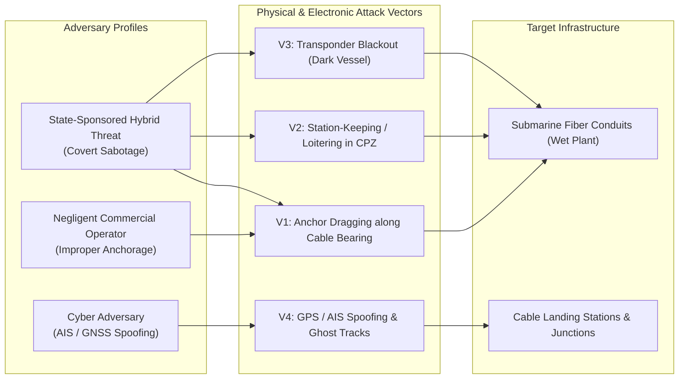
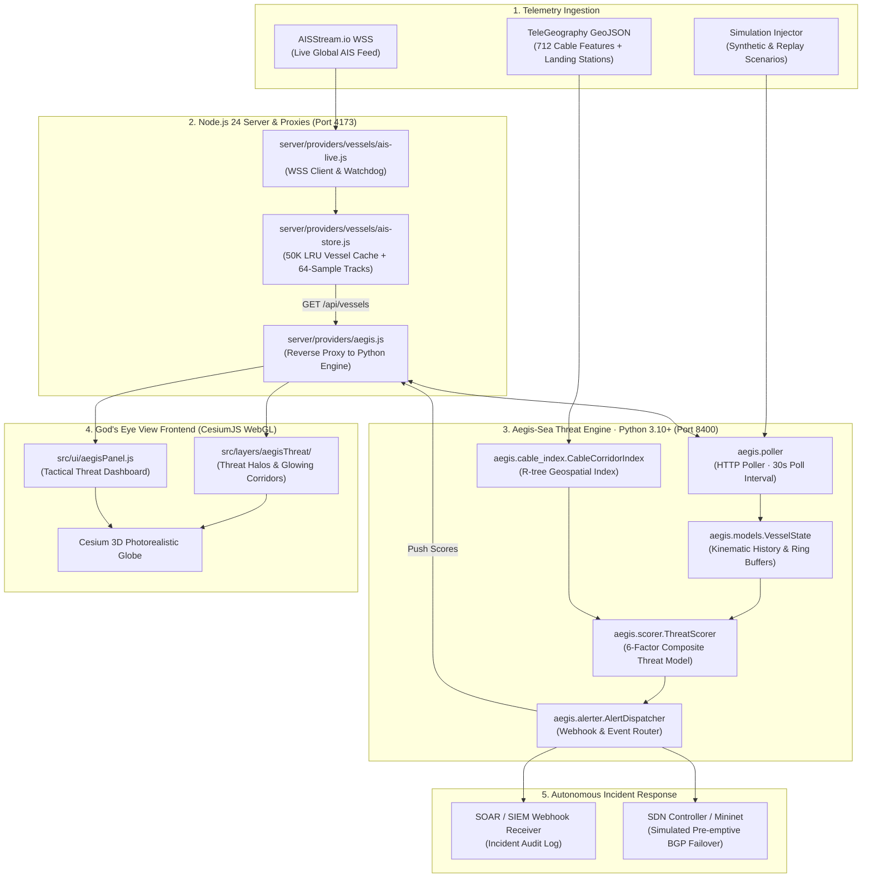
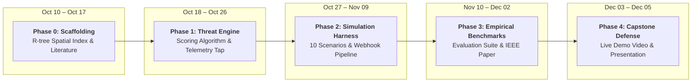

<div align="center">

# 🛡️ Aegis-Sea

### A Cyber-Physical Threat Intelligence & Automated Incident Response Framework for Critical Cloud Infrastructure

[](https://www.fordham.edu/)
[-darkgreen?style=for-the-badge)](#-academic-specifications--ieee-paper-structure)
[](#-quick-start--local-setup)
[](#-quick-start--local-setup)
[](https://github.com/bilawalsidhu/gods-eye-view)
[](LICENSE)

**Bridging maritime spatial intelligence with autonomous network defense — detecting threats to submarine cables *before* physical severance occurs.**

---

*Fordham University · Department of Computer and Information Sciences*  
*CISC 6090: Capstone in Cybersecurity · Advisor: Dr. Thaier Hayajneh*

**Author:** Rayed Jawad · [rjawad1@fordham.edu](mailto:rjawad1@fordham.edu)  
**Upstream Foundation:** [God's Eye View](https://github.com/bilawalsidhu/gods-eye-view) by [Bilawal Sidhu](https://github.com/bilawalsidhu)

</div>

---

## 📑 Table of Contents

- [1. Executive Summary & Problem Formulation](#1-executive-summary--problem-formulation)
  - [The Physical Foundation of the Global Cloud](#the-physical-foundation-of-the-global-cloud)
  - [The Logical-Physical Divide](#the-logical-physical-divide)
  - [Real-World Incident Precedents](#real-world-incident-precedents)
- [2. The Core Paradigm Shift](#2-the-core-paradigm-shift)
- [3. Threat Model & Adversary Taxonomy](#3-threat-model--adversary-taxonomy)
  - [Attack Vectors & Threat Actors](#attack-vectors--threat-actors)
  - [AIS Protocol Vulnerabilities](#ais-protocol-vulnerabilities)
- [4. System Architecture & Technical Design](#4-system-architecture--technical-design)
  - [End-to-End Component Topology](#end-to-end-component-topology)
  - [Data Pipeline & Feed Tap Strategy](#data-pipeline--feed-tap-strategy)
  - [Submarine Cable Spatial Indexing (R-tree)](#submarine-cable-spatial-indexing-r-tree)
- [5. Mathematical Threat Scoring Framework](#5-mathematical-threat-scoring-framework)
  - [Composite Threat Score Formulation](#composite-threat-score-formulation)
  - [Detailed Factor Formulations](#detailed-factor-formulations)
  - [Threshold Policy & Response Matrix](#threshold-policy--response-matrix)
- [6. Automated Incident Response & SDN Failover Pipeline](#6-automated-incident-response--sdn-failover-pipeline)
  - [Webhook Alert Dispatch Schema](#webhook-alert-dispatch-schema)
  - [Simulated SDN Fast-Failover Mechanics](#simulated-sdn-fast-failover-mechanics)
- [7. Event Simulation Harness & Scenario Matrix](#7-event-simulation-harness--scenario-matrix)
  - [Harness Architecture](#harness-architecture)
  - [Standardized 10-Scenario Benchmark Suite](#standardized-10-scenario-benchmark-suite)
  - [Three-Way Baseline Detector Comparison](#three-way-baseline-detector-comparison)
- [8. Empirical Evaluation Methodology](#8-empirical-evaluation-methodology)
  - [Classification & Latency Metrics](#classification--latency-metrics)
  - [Evaluation Artifacts & Visualizations](#evaluation-artifacts--visualizations)
- [9. Phase-by-Phase Development Roadmap](#9-phase-by-phase-development-roadmap)
- [10. Quick Start & Local Setup](#10-quick-start--local-setup)
- [11. Repository & File Structure](#11-repository--file-structure)
- [12. Academic Specifications & IEEE Paper Structure](#12-academic-specifications--ieee-paper-structure)
- [13. Comprehensive Literature Review & References](#13-comprehensive-literature-review--references)
- [14. Acknowledgments & Provenance](#14-acknowledgments--provenance)

---

## 1. Executive Summary & Problem Formulation

### The Physical Foundation of the Global Cloud
The global Internet is commonly perceived as an abstract, ethereal mesh of cloud instances, content delivery networks, and distributed software-defined fabrics. In reality, **over 95% of transcontinental digital communications** transit across a fragile, physical seabed mesh of submarine fiber-optic cables. These conduits—frequently possessing outer armored diameters no larger than 20 to 50 millimeters—rest directly upon the continental shelf and ocean floor, traversing acute maritime choke points such as the Baltic Sea, the Red Sea, the Bab-el-Mandeb Strait, and the Malacca Strait.

### The Logical-Physical Divide
Modern enterprise Security Operations Centers (SOCs) maintain state-of-the-art visibility into the logical network stack:
- NetFlow / IPFIX flow telemetry
- Border Gateway Protocol (BGP) routing updates
- SIEM log aggregation and automated SOAR runbooks
- Optical Time-Domain Reflectometry (OTDR) and Loss-of-Signal (LoS) monitors

However, **physical perimeter defense and maritime domain surveillance operate in complete isolation from logical network layers**. Physical perimeter surveillance is managed by coast guards, navies, and port authorities using Automatic Identification System (AIS) transponders and coastal radar. Logical security engineers have zero real-time visibility into maritime kinematic anomalies occurring directly above critical subsea cable protection zones.

```
┌────────────────────────────────────────────────────────────────────────────────────────┐
│                                 THE CONTEMPORARY BLIND SPOT                            │
│                                                                                        │
│   [ Maritime Physical Layer ]                         [ Logical Cloud Layer ]          │
│   • AIS vessel transponders                           • BGP route tables & NetFlow     │
│   • Vessel speed & heading anomalies                  • Optical Time-Domain Reflectometry│
│   • Anchor deployments & loitering patterns           • SIEM / SOAR alert queues       │
│                                                                                        │
│             │                                                     │                    │
│             ╳   ZERO CORRELATION (PHYSICAL PERIMETER ISOLATION)   ╳                    │
│             ▼                                                     ▼                    │
│   "Vessel drags anchor over cable                      "Alert fires only AFTER cable   │
│    corridor for 80+ nautical miles"                     suffers structural severance"  │
└────────────────────────────────────────────────────────────────────────────────────────┘
```

### Real-World Incident Precedents
Between late 2024 and early 2025, physical vulnerability turned into kinetic disruption:
1. **The C-Lion1 & BCS East-West Severances (November 2024):** The Chinese-flagged bulk carrier *Yi Peng 3* dropped its port anchor and dragged it across the Baltic Sea seabed for over 100 nautical miles, severing the C-Lion1 cable (connecting Finland and Germany) and the BCS East-West cable (connecting Lithuania and Sweden). In both instances, the vessel exhibited characteristic kinematic signatures: a sudden speed drop from 11 knots to ~2–3 knots while maintaining propulsion directly across charted cable protection zones.
2. **The Red Sea Cable Severances (Early 2024–2025):** The sinking and uncontrolled drifting of cargo vessels in the Bab-el-Mandeb Strait severed multiple subsea lines (including SEACOM, EIG, and AAE-1), degrading up to 25% of internet traffic flowing between Asia, the Middle East, and Europe.

In every case, alerts were generated only **after physical rupture occurred**. Cable repair ships required weeks to deploy, costing millions in repair overhead, transit penalties, and global latency degradation. **Aegis-Sea** provides the predictive, pre-severance mitigation framework missing from modern infrastructure defense.

---

## 2. The Core Paradigm Shift

Aegis-Sea forks and transforms the viral open-source spatial intelligence platform **[God's Eye View](https://github.com/bilawalsidhu/gods-eye-view)** from a passive 3D situational visualization tool into an **active, cyber-physical threat-hunting and autonomous defense engine**:

| Operational Dimension | Upstream God's Eye View | Aegis-Sea Framework (This Capstone) |
| :--- | :--- | :--- |
| **Primary Paradigm** | Passive spatial surveillance & contact tracking | Active cyber-physical threat hunting & early response |
| **Geospatial Correlation** | Independent layers rendered side-by-side in Cesium | Real-time R-tree spatial indexing correlating vessels with 712 subsea cables |
| **Behavioral Profiling** | Displays raw kinematics (SOG, COG, Heading) | Evaluates kinematic signatures (speed drops, loitering, anchor dragging) |
| **Threat Quantification** | None; human analyst must manually spot threats | Real-time continuous 6-factor composite Threat Score ($0 \le T \le 100$) |
| **Incident Response** | None; exploratory manual inspection | Automated webhooks to SOAR pipelines + simulated SDN Fast-Failover |
| **Scientific Validation** | Visual proof-of-concept | Deterministic simulation harness, 10 scenario benchmarks, ROC/PR curves |

---

## 3. Threat Model & Adversary Taxonomy

### Attack Vectors & Threat Actors



1. **State-Sponsored Gray-Zone Sabotage:** A merchant vessel operating under commercial flags is tasked with deliberate infrastructure denial. The ship deploys its anchor in shallow waters (< 100m) while under power, dragging the fluke across designated cable coordinates. Transponders may be intermittently cycled off to obscure intent.
2. **Negligent Merchant Anchorage:** A merchant ship suffering engine failure, heavy weather, or navigational error drops anchor or drifts inside charted Cable Protection Zones (CPZs) in violation of maritime notices to mariners.
3. **Electronic & Spoofing Warfare:** Regional GNSS jamming or Software-Defined Radio (SDR) AIS spoofing creates false vessel positions or ghost tracks, disguising hostile vessels or overwhelming maritime surveillance feeds with false alarms.

### AIS Protocol Vulnerabilities
As documented by Balduzzi et al. (ACSAC 2014), the ITU-R M.1371 Automatic Identification System protocol operates in the clear over VHF (161.975 MHz and 162.025 MHz) without cryptographic signatures, origin authentication, or replay protection:
- **Zero Authentication:** Any software-defined radio (e.g., HackRF, RTL-SDR) can transmit forged AIS messages.
- **Position Falsification:** Malicious actors can report coordinates far from their physical location.
- **Intentional Silence:** Vessels can turn off Class A transponders with a bridge switch, creating surveillance dead zones prior to sabotage.

---

## 4. System Architecture & Technical Design

### End-to-End Component Topology



### Data Pipeline & Feed Tap Strategy
God's Eye View's server architecture features a resilient upstream connection to `wss://stream.aisstream.io/v0/stream`. AISStream strictly enforces a limit of **one active WebSocket connection per API key**. If the Python engine attempted to open a second connection using the same key, AISStream would terminate the primary session.

**Solution:** The Python engine operates as an asynchronous client polling the Node server's `/api/vessels` endpoint at a configurable cadence (default: 30 seconds). The Node server maintains the single persistent WebSocket, watchdog recovery backoff ladder (`[5s, 15s, 60s, 300s]`), deduplication, and track ring buffers (64 samples per MMSI).

### Submarine Cable Spatial Indexing (R-tree)
The TeleGeography dataset provides 712 distinct cable feature polylines and hundreds of landing points. Querying all 712 multi-point polylines against tens of thousands of active vessels in brute-force $O(N \times M)$ time would stall real-time evaluation.

Aegis-Sea builds a two-tier spatial index using `rtree` and `shapely`:
1. **Tier 1 (Bounding-Box Pruning):** The R-tree spatial index indexes the bounding envelopes of each cable's 9 Nautical Mile (NM) Alert Zone. A spatial point query for vessel $(lon, lat)$ executes in $O(\log M)$ time.
2. **Tier 2 (Exact Geodesic Distance):** For candidate cable segments returned by Tier 1, exact orthogonal distance $d(v, c)$ and intersection tests against the 3 NM Cable Protection Zone (CPZ) are calculated.

---

## 5. Mathematical Threat Scoring Framework

### Composite Threat Score Formulation
For each vessel $v$ within the spatial alert corridor of subsea cable $c$ at timestamp $t$, Aegis-Sea calculates a continuous **Composite Threat Score** $T_{v,c}(t) \in [0, 100]$:

$$T_{v,c}(t) = \min\Biggl(100, \; \sum_{i \in \mathcal{F}} w_i \cdot S_i(v, c, t)\Biggr)$$

$$\text{subject to} \quad \sum_{i \in \mathcal{F}} w_i = 100, \quad S_i \in [0, 1]$$

Where $\mathcal{F} = \{\text{prox}, \text{speed}, \text{loiter}, \text{heading}, \text{anchor}, \text{dark}\}$ represents the set of evaluation factors.

### Detailed Factor Formulations

#### 1. Spatial Proximity Score ($S_{\text{prox}}$) — Weight: $w_p = 30$
Measures orthogonal distance $d(v,c)$ from the vessel to the nearest segment of cable $c$, normalized over maximum alert horizon $d_{\max} = 9\text{ NM}$ (~16.67 km):
$$S_{\text{prox}}(v, c) = \max\left(0, \; 1 - \frac{d(v, c)}{d_{\max}}\right)^2$$
The quadratic exponent models risk concentration: vessels within 1 NM of the cable produce scores $> 0.78$, whereas vessels 8 NM away score $< 0.02$.

#### 2. Kinematic Speed Anomaly ($S_{\text{speed}}$) — Weight: $w_s = 20$
Evaluates deviation from standard merchant cruising velocity ($12\text{--}24\text{ kn}$). Anchor dragging typically requires propulsion power at abnormally low speeds ($1.0\text{--}3.5\text{ kn}$):
$$S_{\text{speed}}(v) = \frac{1}{1 + \exp\left(k_s \cdot (v_{\text{sog}} - v_{\text{mid}})\right)}$$
*Parameters: $v_{\text{mid}} = 4.0\text{ kn}$, steepness $k_s = 1.2$. A vessel at $1.5\text{ kn}$ yields $S_{\text{speed}} \approx 0.95$; a vessel at $15\text{ kn}$ yields $S_{\text{speed}} \approx 0.00$.*

#### 3. Loitering & Dwell Time ($S_{\text{loiter}}$) — Weight: $w_l = 20$
Quantifies sustained station-keeping inside the cable alert corridor:
$$S_{\text{loiter}}(v, c, t) = \min\left(1.0, \; \frac{t - t_{\text{enter}}(v, c)}{\tau_{\text{loiter}}}\right)$$
*Where $t_{\text{enter}}$ is the epoch when vessel $v$ entered the alert zone, and $\tau_{\text{loiter}} = 3{,}600\text{ s}$ (60 minutes).*

#### 4. Heading & Track Alignment ($S_{\text{heading}}$) — Weight: $w_h = 10$
Calculates alignment between the vessel's Course Over Ground ($\theta_{\text{cog}}$) and the bearing of the closest subsea cable segment ($\theta_{\text{cable}}$):
$$S_{\text{heading}}(v, c) = |\cos(\theta_{\text{cog}} - \theta_{\text{cable}})|$$
Vessels traveling parallel to the cable ($0^\circ$ or $180^\circ$) maximize exposure time over the cable trench; vessels dragging perpendicular ($90^\circ$ or $270^\circ$) represent high-risk severance intercepts.

#### 5. Anchor Drop Signature ($S_{\text{anchor}}$) — Weight: $w_a = 15$
Detects the primary mechanical signature of an anchor deployment while inside the 3 NM Cable Protection Zone:
$$S_{\text{anchor}}(v) = \begin{cases} 
1.0 & \text{if } \Delta t_{\text{decel}} \le 600\text{s} \text{ where } v_{\text{prior}} > 6.0\text{ kn} \land v_{\text{current}} \le 1.5\text{ kn} \land d(v,c) \le d_{\text{cpz}} \\
0.0 & \text{otherwise}
\end{cases}$$

#### 6. AIS Transponder Blackout ($S_{\text{dark}}$) — Weight: $w_d = 5$
Penalizes transponder silence when a vessel was last observed inside or heading toward an alert zone:
$$S_{\text{dark}}(v, t) = \min\left(1.0, \; \frac{t - t_{\text{last}}(v)}{\tau_{\text{dark}}}\right)$$
*Where $\tau_{\text{dark}} = 1{,}800\text{ s}$ (30 minutes).*

### Threshold Policy & Response Matrix

| Level | Score Range | Color Badge | System State | Triggered Actions |
| :--- | :---: | :---: | :--- | :--- |
| **NORMAL** | $0 \le T \le 30$ | 🟢 GREEN | Normal Transit | Background logging; no operator interruption. |
| **ELEVATED** | $31 \le T \le 60$ | 🟡 YELLOW | Advisory Watch | Vessel highlighted on Cesium 3D HUD; telemetry polling rate doubled. |
| **HIGH** | $61 \le T \le 80$ | 🟠 ORANGE | Active Threat | Automated webhook dispatched to SOC SIEM/Slack; pre-incident ticket generated. |
| **CRITICAL** | $81 \le T \le 100$ | 🔴 RED | Imminent Severance | Emergency SOAR webhook + automated simulated SDN BGP failover & traffic link drain. |

---

## 6. Automated Incident Response & SDN Failover Pipeline

### Webhook Alert Dispatch Schema
When a vessel breaches the **HIGH** ($T \ge 61$) or **CRITICAL** ($T \ge 81$) threshold, the `AlertDispatcher` formats an event payload complying with modern SOAR intake specifications (e.g., Splunk SOAR, Palo Alto Cortex XSOAR, PagerDuty):

```json
{
  "event_id": "aegis-alert-20261114-082911-3419",
  "timestamp": "2026-11-14T08:29:11.204Z",
  "threat_level": "CRITICAL",
  "threat_score": 88.4,
  "vessel": {
    "mmsi": "413379000",
    "name": "YI PENG 3",
    "imo": "9224984",
    "ship_type": "Bulk Carrier",
    "coordinates": {"lat": 55.3341, "lon": 15.4812},
    "sog_knots": 1.8,
    "cog_degrees": 218.4,
    "heading_degrees": 222.0
  },
  "targeted_infrastructure": {
    "cable_id": "c-lion1",
    "cable_name": "C-Lion1 (Finland-Germany)",
    "landing_stations": ["Helsinki, Finland", "Rostock, Germany"],
    "distance_nm": 0.42,
    "in_cpz": true
  },
  "score_breakdown": {
    "proximity_score": 0.91,
    "speed_anomaly_score": 0.94,
    "loiter_score": 0.72,
    "heading_alignment_score": 0.85,
    "anchor_drop_detected": true,
    "ais_gap_detected": false
  },
  "mitigation_instructions": {
    "recommended_action": "TRIGGER_PREEMPTIVE_FAILOVER",
    "affected_bgp_prefixes": ["194.100.0.0/16", "62.236.0.0/15"],
    "backup_transit_paths": ["terrestrial-nordic-ring-02", "baltic-cable-bcs-alt"]
  }
}
```

### Simulated SDN Fast-Failover Mechanics
In production cloud environments, subsea links are provisioned as multi-path BGP peering points. Physical severance forces an abrupt optical signal collapse, generating BGP session tears, route flap damping penalties, and transient packet drops.

Aegis-Sea models proactive remediation via **Software-Defined Networking (SDN) Fast-Failover**:
1. Upon receiving a `CRITICAL` alert, the webhook triggers an SDN controller (simulated using Mininet and OpenFlow rules).
2. The controller injects pre-computed alternative flow paths with lower cost metrics.
3. Traffic is systematically **drained** from the threatened subsea transit link and diverted to redundant terrestrial fibers *before* the physical anchor cut takes place.
4. **Mitigation Latency ($t_{\text{mitigation}}$)** is measured from the moment the alert dispatches until the SDN controller completes flow diversion.

---

## 7. Event Simulation Harness & Scenario Matrix

### Harness Architecture
Because physical sabotage cannot be tested in open waters, Aegis-Sea implements a deterministic **Event Simulation Harness** (`aegis.simulation.harness`). The harness executes scenario files that define synthetic vessel kinematics, trajectories, transponder dropouts, and ground-truth labels.

```
┌────────────────────────────────────────────────────────────────────────┐
│                      EVENT SIMULATION HARNESS                          │
│                                                                        │
│  [ Synthetic Waypoint Interpolator ] ──► [ Kinematic Noise Generator ]  │
│                     │                                   │              │
│                     ▼                                   ▼              │
│         [ Deterministic Clock ] ────────► [ Aegis-Sea Engine ]         │
│                                                   │                    │
│                                                   ▼                    │
│                                       [ Benchmark Evaluator ]          │
│                                       • Precision / Recall / F1        │
│                                       • Confusion Matrix Heatmap       │
│                                       • Lead-Time Latency Analysis     │
└────────────────────────────────────────────────────────────────────────┘
```

### Standardized 10-Scenario Benchmark Suite

| ID | Scenario Designation | Kinematic Profile & Maneuver | Ground Truth | Expected Level | Target Metric |
|:--:|:---|:---|:---:|:---:|:---|
| **S01** | **Normal High-Speed Transit** | Container ship crossing C-Lion1 at 18.5 kn, course perpendicular ($90^\circ$). | Benign | 🟢 GREEN | No false alarm ($T < 25$) |
| **S02** | **Standard Slow Merchant Transit** | Tanker transiting at 5.5 kn along charted shipping corridor 6 NM off cable. | Benign | 🟡 YELLOW | Advisory only ($T < 45$) |
| **S03** | **Authorized Off-Cable Loiter** | Survey vessel station-keeping at 2.0 kn, 8 NM away from cable corridor. | Benign | 🟡 YELLOW | Suppressed alarm ($T < 50$) |
| **S04** | **Legitimate Trawling Activity** | Fishing trawler towing gear at 3.0 kn in shallow waters, 4 NM outside CPZ. | Benign | 🟡 YELLOW | No critical failover ($T < 55$) |
| **S05** | ***Yi Peng 3* C-Lion1 Sabotage** | Bulk carrier slows from 11 kn to 1.8 kn; drags anchor over cable for 80 NM. | **Threat** | 🔴 RED | Rapid alarm ($T \ge 85$) |
| **S06** | **Stationary Anchor Drop in CPZ** | Cargo ship drops speed from 8 kn to 0.2 kn directly atop subsea line (< 0.2 NM). | **Threat** | 🔴 RED | Anchor trigger ($T \ge 90$) |
| **S07** | **Parallel Cable Drag Run** | Vessel maintains 2.2 kn course parallel ($0^\circ$) to subsea cable trench for 25 NM. | **Threat** | 🟠 ORANGE | Dwell alert ($T \ge 75$) |
| **S08** | **Dark Approach Sabotage** | Vessel turns off AIS 2 NM before cable, slows to 1.5 kn, reappears 1 hr later. | **Threat** | 🟠 ORANGE | Dark penalty ($T \ge 70$) |
| **S09** | **Sudden Deceleration at Crossing** | Vessel cruising at 12 kn suddenly brakes to 0.5 kn directly at cable crossing. | **Threat** | 🔴 RED | Anchor trigger ($T \ge 85$) |
| **S10** | **Multi-Vessel Swarm Convergence** | 3 unidentified vessels converge within 1 NM of a critical multi-cable junction. | **Threat** | 🔴 RED | High composite ($T \ge 90$) |

### Three-Way Baseline Detector Comparison
To rigorously validate the composite framework for academic publication, Aegis-Sea benchmarks its 6-factor model against two standard naive baselines across all scenarios:

| Detector Paradigm | Detection Logic / Trigger Rule | Expected Failure Mode |
|:---|:---|:---|
| **Baseline 1: Proximity Only** | Alert if $d(v, c) \le 3.0\text{ NM}$ | Catastrophic False Positive Rate; every normal vessel crossing a cable triggers an alarm. |
| **Baseline 2: Speed + Proximity** | Alert if $d(v, c) \le 3.0\text{ NM} \land v_{\text{sog}} \le 3.0\text{ kn}$ | Misses high-speed anchor drops; cannot differentiate legitimate fishing from hostile dragging. |
| **Aegis-Sea (Full Composite)** | Multi-factor weighted sum ($T \ge 61$ for Orange, $T \ge 81$ for Red) | Maximizes F1 score; suppresses alarms for authorized traffic while detecting stealthy sabotage. |

---

## 8. Empirical Evaluation Methodology

### Classification & Latency Metrics
Every benchmark run generates a structured evaluation summary:

$$\text{Precision} = \frac{TP}{TP + FP}, \quad \text{Recall} = \frac{TP}{TP + FN}, \quad F_1 = 2 \cdot \frac{\text{Precision} \cdot \text{Recall}}{\text{Precision} + \text{Recall}}$$

$$\Delta t_{\text{detection}} = t_{\text{alert}} - t_{\text{onset}}$$

$$\Delta t_{\text{mitigation}} = t_{\text{intercept}} - t_{\text{alert}}$$

| Empirical Metric | Benchmark Target | Academic Significance |
|:---|:---:|:---|
| **Detection Accuracy** | $\ge 90.0\%$ | Overall classification correctness across all benign and threat runs. |
| **Precision** | $\ge 85.0\%$ | Protects network engineers from operational alert fatigue. |
| **Recall (Sensitivity)** | $\ge 95.0\%$ | Guarantees zero undetected physical anchor-dragging events. |
| **F1 Score** | $\ge 88.0\%$ | Balanced harmonic mean under imbalanced maritime traffic classes. |
| **False Positive Rate** | $\le 12.0\%$ | Maximum tolerable false alarm rate in active shipping lanes. |
| **Detection Latency** | $\le 5.0\text{ min}$ | Mean time from hostile maneuver onset to alarm generation. |
| **Mitigation Lead Time** | $\ge 15.0\text{ min}$ | Advance warning buffer provided before physical anchor-cable contact. |
| **SDN Failover Execution** | $\le 500\text{ ms}$ | Time required to divert network flows upon webhook receipt. |

### Evaluation Artifacts & Visualizations
The test suite automatically generates publication-grade figures saved to `results/`:
1. **Confusion Matrix Heatmap (`confusion_matrix.png`):** Normal vs. Elevated vs. High vs. Critical counts.
2. **ROC Curve (`roc_curve.png`):** True Positive Rate vs. False Positive Rate parameterized across threshold $\tau \in [0, 100]$.
3. **Precision-Recall Curve (`pr_curve.png`):** Performance under operational class imbalance.
4. **Threat Score Boxplots (`threat_distributions.png`):** Distribution of threat scores across each of the 10 scenario types.
5. **Detection Lead Time Histogram (`lead_time_distribution.png`):** Distribution of advance warning buffers.
6. **Sensitivity Matrix (`weight_sensitivity.png`):** Impact on F1 score when varying weights $w_i \pm 20\%$.

---

## 9. Phase-by-Phase Development Roadmap

Designed for execution by a working professional around academic milestones (CISC 6090: Capstone in Cybersecurity):



| Phase | Time Horizon | Key Focus & Technical Deliverables | Fordham Academic Milestone |
| :---: | :---: | :--- | :---: |
| **Phase 0** | **Oct 10 – Oct 17** | Environment setup, R-tree cable indexing (`shapely`/`rtree`), literature review | **Related Work (Oct 17)** |
| **Phase 1** | **Oct 18 – Oct 26** | 6-factor composite scoring engine, `/api/vessels` polling tap, Cesium threat HUD | *Core Engine Verification* |
| **Phase 2** | **Oct 27 – Nov 09** | Deterministic simulation harness, 10 benchmark scenarios, SOAR webhook dispatcher | **Progress Report (Oct 31)** |
| **Phase 3** | **Nov 10 – Dec 02** | Automated benchmark runs, ROC/PR curves, complete IEEE conference paper | **Draft Report (Dec 03)** |
| **Phase 4** | **Dec 03 – Dec 05** | High-definition screencast video demo, defense slide deck | **Final Presentation (Dec 05)** |

### Phase 0: Scaffolding & Geospatial Indexing `Oct 10 – Oct 17`
- [x] Establish and verify local God's Eye View runtime (Node.js 24 LTS + Vite + Cesium).
- [x] Inspect and document live AISStream WebSocket and TeleGeography cable layers.
- [ ] Initialize Python environment (`aegis-engine/`) with `shapely`, `rtree`, `fastapi`, and `pydantic`.
- [ ] Build `CableCorridorIndex` with R-tree spatial indexing over all 712 subsea cable geometries.
- [ ] Complete and submit the **Related Work** literature review document.

### Phase 1: Threat Scoring Core & API Ingestion `Oct 18 – Oct 26`
- [ ] Build `AISPoller` client polling `/api/vessels` and caching kinematic states in `VesselState`.
- [ ] Implement mathematical formulations for all 6 scoring factors in `aegis.scorer`.
- [ ] Construct FastAPI service exposing `GET /api/threats` and `GET /api/threats/{mmsi}`.
- [ ] Integrate Node.js reverse proxy (`server/providers/aegis.js`) and Cesium frontend threat layer.

### Phase 2: Simulation Harness & Automated Response `Oct 27 – Nov 9`
- [ ] Develop deterministic simulation engine (`aegis.simulation.harness`).
- [ ] Author JSON scenario configurations for all 10 benchmark scenarios (including *Yi Peng 3*).
- [ ] Implement `AlertDispatcher` with SOAR JSON webhook emission.
- [ ] Build standalone mock webhook receiver and incident log audit recorder.
- [ ] Complete and submit the **Progress Report** (due Oct 31).

### Phase 3: Empirical Benchmarking & IEEE Paper Authoring `Nov 10 – Dec 3`
- [ ] Execute automated benchmark runs across the 10 scenarios and naive baselines.
- [ ] Generate all publication charts, confusion matrices, and ROC curves using `matplotlib` / `seaborn`.
- [ ] Author the complete IEEE research paper (≥ 5,000 words; planned ~8,000 words).
- [ ] Format and compile final document with all figures, equations, and 15 academic citations.
- [ ] Submit final **Draft Report** (due Dec 3).

### Phase 4: Final Demonstration & Presentation `Dec 3 – Dec 5`
- [ ] Record a high-definition screencast demonstration of an anchor-drag incident triggering SDN rerouting.
- [ ] Prepare slide presentation covering threat landscape, architecture, math model, and metrics.
- [ ] Deliver **Final Capstone Defense & Presentation** (Dec 5).

---

## 10. Quick Start & Local Setup

### Prerequisites
- **Node.js:** Node 24 LTS (`>=24.14.0 <25`) or Node 26.
- **Python:** Python 3.10+ with `pip`.
- **Git:** Git 2.40+.

### 1. Launch the Geospatial Visualization Frontend
```bash
# Clone the repository
git clone https://github.com/R4Y3D/aegis-sea.git
cd aegis-sea

# Install locked dependencies
npm ci

# Run diagnostics
npm run doctor

# Start Vite development server
npm run dev
```
Open **`http://localhost:4173`** in your browser. Toggle the **Vessels** and **Submarine Cables** layers in the display controls.

> **Credentials:** To enable live global vessel telemetry, obtain a free API key at [aisstream.io](https://aisstream.io/) and add `AISSTREAM_API_KEY=your_key_here` to your root `.env` file.

### 2. Launch the Aegis-Sea Python Threat Engine
```bash
# Navigate to engine directory
cd aegis-engine

# Initialize and activate Python virtual environment
python -m venv .venv

# On Windows PowerShell:
.venv\Scripts\Activate.ps1

# On Linux / macOS:
# source .venv/bin/activate

# Install required packages
pip install -r requirements.txt

# Start the threat scoring engine
uvicorn aegis.main:app --host 127.0.0.1 --port 8400 --reload
```

### 3. Run Benchmark Scenarios & Generate Metrics
```bash
# Execute the full 10-scenario simulation suite
python -m aegis.simulation.runner --all

# Run a specific benchmark scenario
python -m aegis.simulation.runner --scenario 05_anchor_drag_yipeng3

# Generate publication-ready evaluation charts
python -m aegis.evaluation.runner --output results/
```

---

## 11. Repository & File Structure

```
aegis-sea/
├── server/                               # Node.js backend & Vite development server
│   └── providers/
│       ├── vessels/                       # Live AISStream WebSocket provider & in-memory cache
│       │   ├── ais-live.js                #   WebSocket watchdog & /api/vessels middleware
│       │   └── ais-store.js               #   50K vessel LRU store & track ring buffers
│       └── aegis.js                       # Reverse proxy routing to Python engine (port 8400)
│
├── src/                                  # Frontend client (Vanilla ES Modules + CesiumJS)
│   ├── layers/
│   │   ├── vessels/                       # AIS vessel billboard rendering & inspector cards
│   │   ├── submarineCables/               # Subsea cable polylines & landing point billboards
│   │   └── aegisThreat/                  # Threat overlay: color-coded risk halos & corridors
│   │       ├── index.js
│   │       ├── rendering.js
│   │       └── state.js
│   ├── data/local_data/
│   │   └── telegeography_submarine_cables/
│   │       ├── cable-geo.json             # 712 submarine cable geometries (GeoJSON)
│   │       └── landing-point-geo.json     # Subsea landing station coordinates (GeoJSON)
│   └── ui/
│       └── aegisPanel.js                  # Real-time incident response tactical dashboard
│
├── aegis-engine/                         # Python threat-scoring microservice & test harness
│   ├── pyproject.toml                     # Modern build & package configuration
│   ├── requirements.txt                   # FastAPI, Shapely, Rtree, NumPy, Pydantic
│   ├── aegis/
│   │   ├── main.py                       # FastAPI entry point & lifespan manager
│   │   ├── config.py                     # Weights, thresholds, and corridor parameters
│   │   ├── models.py                     # Pydantic models (VesselState, ThreatAssessment)
│   │   ├── cable_index.py                # R-tree spatial index over cable geometries
│   │   ├── poller.py                     # Asynchronous polling client for /api/vessels
│   │   ├── scorer.py                     # 6-factor composite threat scoring engine
│   │   ├── alerter.py                    # Webhook dispatcher & incident router
│   │   └── api.py                        # REST endpoints (/api/threats, /api/health)
│   ├── simulation/
│   │   ├── harness.py                    # Deterministic scenario replay engine
│   │   ├── scenario.py                   # Scenario schemas & waypoint interpolator
│   │   └── scenarios/                    # JSON scenario library (S01–S10)
│   │       ├── 01_normal_transit.json
│   │       ├── 05_anchor_drag_yipeng3.json
│   │       └── ...
│   ├── evaluation/
│   │   ├── runner.py                     # Batch evaluation across baseline detectors
│   │   ├── metrics.py                    # Accuracy, Precision, Recall, F1, Latency
│   │   └── plots.py                      # Matplotlib / Seaborn visualization generators
│   └── tests/
│       ├── test_cable_index.py
│       ├── test_scorer.py
│       └── test_scenarios.py
│
├── paper/                                # Final IEEE capstone research paper
│   ├── main.tex                          # LaTeX document source
│   ├── references.bib                    # 15 academic references in BibTeX format
│   └── figures/                          # System diagrams, ROC curves, confusion matrices
│
├── results/                              # Generated benchmark plots & evaluation JSON logs
└── docs/
    └── UPSTREAM_README.md                # Preserved upstream God's Eye View documentation
```

---

## 12. Academic Specifications & IEEE Paper Structure

To fulfill Fordham University CISC 6090 capstone requirements, the research paper will be formatted according to standard IEEE conference guidelines with an expected length between **7,000 and 8,500 words** (exceeding the 5,000-word minimum):

| Section | Planned Word Count | Key Contents & Academic Deliverables |
| :--- | :---: | :--- |
| **Abstract** | ~250 words | Problem context, limitations of passive monitoring, composite scoring model, key empirical findings (Accuracy, Precision, Recall, Lead Time). |
| **I. Introduction** | ~1,000 words | Geopolitical and cloud dependence on subsea fiber; Baltic Sea 2024 incidents; the logical-physical divide; outline of paper contributions. |
| **II. Related Work** | ~1,500 words | Comprehensive literature survey across 7 domains (AIS anomaly models, GeoTrackNet, AIS spoofing, CPS modeling, SDN optical failover). |
| **III. Threat Model & Formulation** | ~1,000 words | Adversary capability model (APT vs. negligent civilian); maritime kinematic attack vectors; limitations of AIS protocol trust. |
| **IV. System Architecture** | ~1,200 words | Multi-tier architectural design; R-tree spatial indexing; asynchronous feed tap; integration with CesiumJS WebGL frontend. |
| **V. Threat Scoring Algorithm** | ~1,200 words | Mathematical formalization of the 6 scoring factors; quadratic proximity decay; sigmoid speed anomaly; anchor-drop heuristics. |
| **VI. Simulation & Evaluation** | ~1,000 words | Event simulation harness design; 10 benchmark scenarios; baseline comparison methodologies; metric definitions. |
| **VII. Results & Discussion** | ~1,500 words | Empirical findings; confusion matrices; ROC/PR curves; detection lead-time distributions; sensitivity analysis; operational tradeoffs. |
| **VIII. Conclusion & Future Work** | ~500 words | Summary of contributions; limitations; future integration of deep learning (GeoTrackNet VRNN) and Distributed Acoustic Sensing (DAS). |
| **References** | — | 15 peer-reviewed citations (13 IEEE/ACM venues, 2 policy monographs). |

---

## 13. Comprehensive Literature Review & References

The project grounds its scientific contributions in 15 academic references spanning **7 core cybersecurity and maritime engineering domains**:

### Domain 1: AIS Anomaly Detection & Maritime Surveillance
1. **GeoTrackNet — A Maritime Anomaly Detector using Probabilistic Neural Network Representation of AIS Tracks and A Contrario Detection**  
   *D. Nguyen, R. Vadaine, G. Hajduch, R. Garello, and R. Fablet*  
   *IEEE Transactions on Intelligent Transportation Systems*, 2021. [arXiv:1912.00682](https://arxiv.org/pdf/1912.00682).  
   *Role in Project:* Foundational reference for probabilistic track representations (VRNNs) and statistical *a contrario* false-alarm suppression.
2. **Malicious AIS Spoofing and Abnormal Stealth Deviations: A Comprehensive Statistical Framework for Maritime Anomaly Detection**  
   *P. Braca, L. M. Millefiori, M. Zorzi, and P. Willett*  
   *IEEE Transactions on Aerospace and Electronic Systems*, 2022.  
   *Role in Project:* Provides kinematic Ornstein-Uhlenbeck stochastic processes justifying the speed and course anomaly factors.
3. **Vessel Trajectory Reconstruction and Anomaly Detection Based on Multi-Task Spatiotemporal Attention Networks**  
   *Z. Xiao, L. Fu, X. Lu, et al.*  
   *IEEE Transactions on Intelligent Transportation Systems*, 2022.  
   *Role in Project:* Theoretical justification for transponder blackout penalty ($S_{\text{dark}}$) and trajectory interpolation during signal gaps.

### Domain 2: AIS Security Vulnerabilities & Spoofing
4. **A Security Evaluation of AIS Automated Identification System**  
   *M. Balduzzi, A. Pasta, and K. Wilhoit*  
   *Proceedings of the 30th Annual Computer Security Applications Conference (ACM ACSAC)*, 2014.  
   *Role in Project:* Foundational vulnerability analysis establishing that AIS lacks encryption, authentication, and replay protection.
5. **Detection of Malicious AIS Position Spoofing by Exploiting Radar Information**  
   *F. Katsilieris, P. Braca, and S. Coraluppi*  
   *16th International Conference on Information Fusion (IEEE FUSION)*, 2013.  
   *Role in Project:* Statistical framework for cross-verifying AIS telemetry against secondary surveillance sensors.
6. **SeaSpoofFinder: Detecting Coordinated GNSS and AIS Manipulation at Sea**  
   *T. Willems et al.*  
   *IEEE Transactions on Dependable and Secure Computing*, 2025.  
   *Role in Project:* Advanced filter separating individual vessel tampering from regional electronic warfare (Baltic/Black Sea GPS jamming).

### Domain 3: Subsea Cable Security & Physical Vulnerability
7. **Undersea Cables: Indispensable, Insecure and Vulnerable to Hybrid Warfare**  
   *R. Sunak (Foreword by Adm. Sir S. Peach)*  
   *Policy Exchange Research Monograph*, 2017.  
   *Role in Project:* Geopolitical framing establishing the critical exposure of undersea fiber conduits to asymmetric gray-zone sabotage.
8. **Critical Undersea Infrastructure Protection: Gray-Zone Sabotage and the Baltic Sea Cable Incidents**  
   *Center for Strategic and International Studies (CSIS) / NATO Maritime Security Studies*  
   *Journal of Baltic Security*, 2024–2025.  
   *Role in Project:* Forensic analysis of the *Yi Peng 3* and *Newnew Polar Bear* anchor-dragging incidents utilized as benchmark ground truths.

### Domain 4: Cyber-Physical Systems Threat Modeling
9. **A Unified Threat Modeling Framework for Cyber-Physical Critical Infrastructures**  
   *S. Al-Dhaqm, R. Abd Razak, K. Siddique, et al.*  
   *IEEE Access*, vol. 9, 2021.  
   *Role in Project:* Structural methodology for bridging logical cyber metrics with physical infrastructure state variables.
10. **Distributed Acoustic Sensing (DAS) for Subsea Cable Monitoring and Perimeter Defense**  
    *Z. Zhan et al. / G. Bolognini*  
    *IEEE Journal of Lightwave Technology*, 2021.  
    *Role in Project:* Identifies dark optical fibers as continuous acoustic strain sensors, contextualized in the paper's future work.

### Domain 5: Maritime Domain Awareness (MDA) & Multi-Sensor Fusion
11. **Multi-Sensor Data Fusion for Maritime Surveillance: Integrating AIS, SAR, and Optical Satellite Imagery**  
    *D. Graziano, M. D'Errico, and G. Di Martino*  
    *IEEE Transactions on Geoscience and Remote Sensing*, 2022.  
    *Role in Project:* Architectural model for correlating spatial geometries with dynamic vessel positions and satellite observations.

### Domain 6: Automated Incident Response & SDN Fast-Failover
12. **Proactive Failure Recovery and Fast Failover in Software-Defined Optical Networks**  
    *X. Cao, M. Tornatore, and B. Mukherjee*  
    *IEEE/ACM Transactions on Networking*, 2020.  
    *Role in Project:* Design blueprint for sub-50ms proactive traffic rerouting upon predictive physical degradation alerts.
13. **SDN-Enabled Dynamic Traffic Engineering and Fast Failover for Resilient Submarine Cable Meshes**  
    *Y. Liu, R. Gu, and Y. Ji*  
    *IEEE Communications Letters*, 2021.  
    *Role in Project:* Traffic engineering algorithms for transoceanic subsea meshes factoring in propagation delay and failure probabilities.

### Domain 7: Threat Scoring Frameworks & Risk Assessment
14. **Dynamic Risk Assessment and Threat Scoring in Maritime Traffic Using Spatial Temporal AIS Analytics**  
    *M. A. Bakdi, V. Kougioumtzoglou, and K. X. Nguyen*  
    *IEEE Transactions on Intelligent Transportation Systems*, 2023.  
    *Role in Project:* Direct mathematical foundation for designing multi-criteria spatial-temporal risk scoring indices.
15. **Quantitative Cyber-Physical Threat Assessment Framework for Critical Infrastructures Based on Attack-Defense Graphs**  
    *J. Tian, M. Zhang, and Y. Shen*  
    *ACM Transactions on Cyber-Physical Systems*, 2022.  
    *Role in Project:* Formal justification for composite scoring algorithms with probabilistic upper bounds.

---

## 14. Acknowledgments & Provenance

- **[God's Eye View](https://github.com/bilawalsidhu/gods-eye-view)** by [Bilawal Sidhu](https://github.com/bilawalsidhu) — The viral open-source 3D spatial intelligence globe serving as the visual and telemetry substrate. Upstream documentation is preserved in [`docs/UPSTREAM_README.md`](docs/UPSTREAM_README.md).
- **[TeleGeography](https://www.submarinecablemap.com/)** — Global submarine cable geographic routes and landing station datasets (CC BY-NC-SA 3.0).
- **[AISStream.io](https://aisstream.io/)** — Real-time worldwide Automatic Identification System WebSocket stream.
- **[CesiumJS](https://cesium.com/)** — High-performance WebGL 3D geospatial rendering engine.
- **Dr. Thaier Hayajneh** — Capstone Advisor and Director of the Fordham Center for Cybersecurity, Fordham University.

---

<div align="center">

**Fordham University · Department of Computer and Information Sciences · 2026**

*Empirical Cyber-Physical Defense for the Foundation of the Global Cloud*

[](https://github.com/R4Y3D/aegis-sea)

</div>
