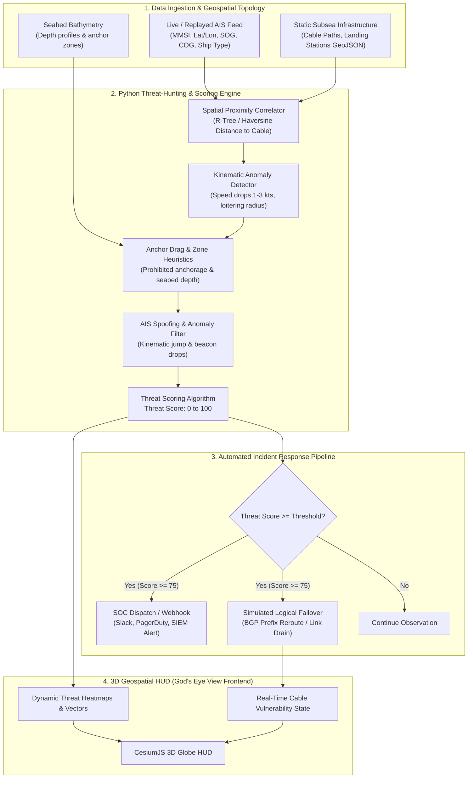

# 🌐 Cyber-Physical Threat Intelligence & Automated Incident Response Framework for Critical Cloud Infrastructure

[](https://github.com/R4Y3D/gods-eye-view)
[](https://www.fordham.edu/)
[](#empirical-validation--expected-outcomes)
[](https://github.com/bilawalsidhu/gods-eye-view)
[](#quick-start--local-setup)
[](#quick-start--local-setup)
[](LICENSE)

> **A Cyber-Physical Incident Response and Threat-Scoring Framework bridging real-time spatial intelligence with autonomous logical network defense for critical cloud physical infrastructure.**

**Author:** Rayed Jawad ([rjawad1@fordham.edu](mailto:rjawad1@fordham.edu))  
**Academic Affiliation:** Department of Computer and Information Sciences, Fordham University  
**Upstream Foundation:** Built on and extending [*God's Eye View*](https://github.com/bilawalsidhu/gods-eye-view) by Bilawal Sidhu  

---

## 📑 Table of Contents

- [Executive Summary](#-executive-summary)
- [The Threat Landscape & Problem Statement](#-the-threat-landscape--problem-statement)
- [The Core Paradigm Shift: From Passive Monitoring to Active Response](#-the-core-paradigm-shift)
- [System Architecture](#-system-architecture)
- [Algorithmic Core & Threat-Scoring Methodology](#-algorithmic-core--threat-scoring-methodology)
- [Simulation & Testing Methodology](#-simulation--testing-methodology)
- [Empirical Validation & Expected Outcomes](#-empirical-validation--expected-outcomes)
- [Quick Start & Local Setup](#-quick-start--local-setup)
- [Project Roadmap](#-project-roadmap)
- [Citations & Acknowledgments](#-citations--acknowledgments)

---

## 📌 Executive Summary

The global cloud computing ecosystem rests upon an illusion of weightless, ethereal connectivity. In reality, **over 95% of international internet traffic flows through a fragile physical mesh of undersea fiber-optic communication cables** crossing narrow geographical choke points on the seabed.

Between late 2024 and early 2025, a series of catastrophic submarine cable cuts across the **Baltic Sea** (including the C-Lion1 and BCS East-West cables) and the **Red Sea** disrupted critical transcontinental internet corridors. In multiple incidents, merchant vessels loitered over designated cable protection zones and dragged anchors across seabed corridors for hundreds of kilometers.

These events exposed a dangerous blind spot in contemporary cybersecurity:
1. **The Logical-Physical Divide:** Modern Security Operations Centers (SOCs) continuously monitor NetFlow, BGP tables, and SIEM logs. However, physical perimeter defense and maritime surveillance operate in complete isolation from logical network layers.
2. **Lagging Detection:** By the time an optical time-domain reflectometer (OTDR) or BGP alert triggers an alert, the physical fiber has already suffered structural severance, requiring months of physical maritime repair and costing millions in rerouting overhead and latency degradation.
3. **Passive Spatial Tools:** While state-of-the-art open-source intelligence platforms like [*God's Eye View*](https://github.com/bilawalsidhu/gods-eye-view) can ingest and visualize live satellite, flight, and Automatic Identification System (AIS) maritime feeds on a photorealistic 3D globe, they remain **passive exploratory tools** that lack automated incident response or cyber-physical threat-correlation capabilities.

This capstone project introduces a **Cyber-Physical Threat Intelligence and Automated Incident Response Framework**. By correlating real-time geospatial vessel telemetry (AIS) with static subsea infrastructure topologies, the framework computes continuous spatial risk scores (0–100) and automatically triggers pre-emptive logical incident response workflows (alerting SOCs, firing SOAR webhooks, and simulating pre-severance BGP traffic failover) *before* physical disruption takes place.

---

## 🌊 The Threat Landscape & Problem Statement

```
+----------------------------------------------------------------------------------------+
|                               CONTEMPORARY BLIND SPOT                                  |
|                                                                                        |
|  [ Maritime Physical Layer ]                   [ Logical Cloud Layer ]                 |
|  - AIS vessel beacons                          - BGP routing tables                    |
|  - Anchor deployments                          - Optical Time-Domain Reflectometry     |
|  - Speed drops / Loitering in cable zones      - SIEM / SOC alert queues               |
|                                                                                        |
|         |                                                |                             |
|         X  NO CORRELATION (PHYSICAL PERIMETER ISOLATION) X                             |
|         v                                                v                             |
|  "Vessel drags anchor across subsea line"       "Alert only AFTER physical cut occurs" |
+----------------------------------------------------------------------------------------+
```

### Key Vulnerabilities
- **Submarine Cable Corridors:** Transoceanic fiber bundles have diameters roughly equivalent to a garden hose in deep water, armored only lightly against trawling and anchor drags in littoral shallows.
- **Asymmetric Sabotage & Negligence:** A single civilian vessel traveling at 1–3 knots dragging an anchor can sever multiple high-capacity subsea conduits simultaneously.
- **Reactive Mitigation Deficit:** Rerouting global cloud workloads typically occurs *reactively* once packet loss spikes or optical loss of signal is confirmed. An automated predictive failover system could shift high-priority BGP prefixes onto redundant terrestrial or submarine routes minutes before physical contact occurs.

---

## ⚡ The Core Paradigm Shift

This project transforms **God's Eye View** from a visualization client into an **active threat-hunting and autonomous defense engine**:

| Capability | Passive Visualization (Upstream God's Eye View) | Active Framework (This Capstone) |
| :--- | :--- | :--- |
| **Data Ingestion** | Ingests live AIS vessel positions & static cable layers | Ingests live AIS + subsea cable geometries + bathymetry into real-time spatial graph |
| **Threat Correlation** | None; human operator must visually spot proximity | Automated real-time geometric intersection & spatial proximity analysis |
| **Behavioral Profiling** | Displays speed and heading metadata | Detects kinematic anomalies: loitering, speed anomalies, anchor drag signatures, spoofing |
| **Threat Scoring** | None | Continuous algorithmic Threat Score ($0 \le T \le 100$) per vessel-cable pair |
| **Incident Response** | None | Automated webhook dispatch, SOC notification, and simulated traffic failover |
| **Verification & Testing** | Manual exploratory inspection | Event simulation harness with synthetic vessel injection and empirical benchmarks |

---

## 🏗️ System Architecture



---

## 🧠 Algorithmic Core & Threat-Scoring Methodology

The algorithmic heart of the framework calculates a continuous **Threat Score ($T$)** between $0$ and $100$ for each vessel $v$ within a threshold radius $R_{\text{alert}}$ of a subsea cable segment $c$:

$$\text{Threat Score}(v, c) = \min\left(100, \; w_p S_{\text{proximity}} + w_k S_{\text{kinematic}} + w_a S_{\text{anchor}} + w_s S_{\text{spoof}}\right)$$

Where the weights satisfy $\sum w_i = 1.0$ and each sub-score is normalized to $[0, 100]$:

### 1. Spatial Proximity Score ($S_{\text{proximity}}$)
Calculated as an exponential decay model based on the minimum geodesic distance $d(v, c)$ between the vessel coordinates and the nearest point on the subsea cable polyline:
$$S_{\text{proximity}} = 100 \times \exp\left(-\frac{d(v, c)}{\lambda}\right)$$
*Where $\lambda$ scales the critical zone (e.g., $1{,}000\text{ m}$). Within $200\text{ m}$, $S_{\text{proximity}} \to 100$.*

### 2. Kinematic & Loitering Anomaly ($S_{\text{kinematic}}$)
Evaluates deviation from standard merchant cruising speed ($12\text{--}22\text{ knots}$) and persistent presence in a localized bounding box:
- **Loitering Duration:** Time elapsed within radius $R$ of the cable corridor without productive forward transit.
- **Speed Anomaly:** Low speed over ground ($\text{SOG} \le 3\text{ kts}$) outside authorized anchorages.

### 3. Anchor Drag Heuristic ($S_{\text{anchor}}$)
Detects the primary physical signature of intentional or negligent seabed cable sabotage:
- Sustained drift speed between $1.0\text{ and }3.5\text{ knots}$.
- Vessel heading aligned with prevailing tidal or wind drift rather than propeller-driven course over ground ($\Delta(\text{HDG}, \text{COG}) \gg 0$).
- Proximity to shallow or intermediate bathymetric depths where ship anchors reach the ocean floor.

### 4. Identity & Spoofing Score ($S_{\text{spoof}}$)
Monitors AIS message regularity and flags anomalies:
- Inconsistent MMSI or IMO metadata against public registries.
- Teleportation or impossible acceleration vectors indicating GPS spoofing.
- Intentional AIS transponder blackout windows immediately preceding entry into cable defense buffers.

---

## 🧪 Simulation & Testing Methodology

To validate the framework without requiring dangerous real-world maritime experiments, the project employs a **controlled event simulation harness**:

```
+-----------------------------------------------------------------------------------------+
|                              SIMULATION TEST HARNESS                                    |
|                                                                                         |
|  [ Baseline Commercial ]      [ Suspicious Loitering ]       [ Hostile Anchor Drag ]    |
|  - Cargo vessel (18 kts)      - Tanker slows to 1 kt         - Bulk carrier (2 kts)     |
|  - Crosses cable at 90 deg    - Circles cable junction       - Heading matches drift    |
|  - Threat Score: 5 / 100      - Threat Score: 62 / 100       - Threat Score: 94 / 100   |
|  - Result: PASSIVE LOG        - Result: WARN TO SOC          - Result: TRIGGER FAILOVER |
+-----------------------------------------------------------------------------------------+
```

1. **Synthetic Vessel Injection:**
   - Injects realistic, configurable synthetic AIS NMEA / JSON messages into the processing pipeline alongside real ambient maritime data.
   - Allows fine-grained control over vessel trajectory, speed curves, anchor status, and transmission intervals.
2. **Scenario Matrix:**
   - **Scenario 1 (Normal Transit):** Cargo vessel crossing subsea cable perpendicular at standard cruising speed ($16\text{ kts}$). *Expected: Low score, no alert.*
   - **Scenario 2 (Fishing / Trawling):** Trawler operating gear near shallow cable landing zone. *Expected: Moderate score, advisory alert.*
   - **Scenario 3 (Loitering Over Cable Junction):** Vessel station-keeping directly above a multi-cable junction for $>3\text{ hours}$. *Expected: High score, SOC notification.*
   - **Scenario 4 (Active Anchor Drag):** Vessel drifting at $2\text{ kts}$ across multiple parallel cables in shallow water. *Expected: Critical score ($>85$), automated webhook fired, automated traffic failover simulated.*
   - **Scenario 5 (Spoofed Telemetry):** Injected vessel with impossible jumps or transponder manipulation near high-value cloud regions.

---

## 📊 Empirical Validation & Expected Outcomes

The research will evaluate the framework using empirical metrics to be documented in a final **IEEE-formatted research paper**:

| Metric | Target Goal | Description |
| :--- | :--- | :--- |
| **Detection Accuracy** | $\ge 95\%$ | Proportion of simulated threat and non-threat events classified correctly |
| **Precision** | $\ge 90\%$ | Ratio of true physical threats among all triggered alerts (minimizing false alarms) |
| **Recall / Sensitivity** | $\ge 98\%$ | Ensuring zero undetected critical anchor-dragging scenarios |
| **False-Positive Rate** | $\le 5\%$ | Maintaining operational viability without causing alert fatigue in SOCs |
| **Mitigation Latency** | $\ge 15\text{ minutes}$ | Lead time provided to network engineers prior to simulated physical impact |
| **Failover Execution** | $< 500\text{ ms}$ | Latency to dispatch webhook and trigger simulated BGP prefix diversion |

### Core Project Deliverables
- [x] **Upstream Ingestion & 3D Visualizer:** God's Eye View client with full subsea cable and AIS vessel rendering.
- [ ] **Python Threat-Hunting Engine:** Standalone microservice performing spatial correlation and threat scoring.
- [ ] **Synthetic Injection Test Suite:** Reproducible benchmark harness simulating real-world maritime attack vectors.
- [ ] **Automated Incident Response Webhooks:** Simulated automated BGP traffic failover and SOC integration.
- [ ] **Empirical Evaluation Data:** Benchmark charts, ROC curves, and false-positive tradeoff analysis.
- [ ] **Academic Publication:** Comprehensive IEEE-formatted paper detailing the mathematical model, methodology, and results.
- [ ] **Live Demonstration:** End-to-end demonstration showing simulated vessel sabotage triggering pre-emptive cloud traffic rerouting.

---

## 🚀 Quick Start & Local Setup

### System Prerequisites
- **Node.js:** Node 24 LTS (`>=24.14.0 <25`) or Node 26.
- **Python:** Python 3.10+ with `pip`.
- **Git:** Git 2.40+.

### 1. Clone the Fork
```bash
git clone https://github.com/R4Y3D/gods-eye-view.git
cd gods-eye-view
```

### 2. Launch the 3D Geospatial Frontend
```bash
# Install locked dependencies
npm ci

# Run environment diagnostics
npm run doctor

# Start Vite local development server
npm run dev
```
Open **`http://localhost:4173`** in your browser.

### 3. Launch the Python Threat Engine (Under Development)
```bash
# Create and activate Python virtual environment
python -m venv .venv

# Windows PowerShell:
.venv\Scripts\Activate.ps1

# Linux / macOS:
# source .venv/bin/activate

# Install requirements (once dependencies are authored)
pip install -r engine/requirements.txt

# Run the scoring engine service
python engine/threat_engine.py
```

---

## 🗺️ Project Roadmap

```
[ Phase 1: Ingestion & Baseline ] ──────────────────────────────────────────> COMPLETED
  - Ingest live AIS, subsea cables, and landing stations on God's Eye View
  - Verify local build, 4,135 unit tests, and Vite dev server

[ Phase 2: Threat Taxonomy & Python Backend ] ──────────────────────────────> IN PROGRESS
  - Design spatial correlation data structures (R-Tree / KD-Tree)
  - Implement 4-component threat scoring algorithm (0-100 scale)

[ Phase 3: Synthetic Event Simulation Harness ] ────────────────────────────> UPCOMING
  - Build synthetic AIS spoofing and loitering injector
  - Execute Scenarios 1-5 across Baltic and Red Sea cable coordinates

[ Phase 4: Automated Incident Response & Failover ] ────────────────────────> UPCOMING
  - Implement webhook pipeline (Slack / PagerDuty / SIEM mock)
  - Simulate pre-emptive BGP prefix rerouting and link draining

[ Phase 5: Empirical Analysis & IEEE Paper ] ───────────────────────────────> UPCOMING
  - Benchmark accuracy, precision, recall, and mitigation lead times
  - Author and compile final IEEE capstone paper and live demo video
```

---

## 📚 Citations & Acknowledgments

- **Upstream Foundation:** [God's Eye View](https://github.com/bilawalsidhu/gods-eye-view) by [Bilawal Sidhu](https://github.com/bilawalsidhu). Preserved upstream documentation is available in [`docs/UPSTREAM_README.md`](docs/UPSTREAM_README.md).
- **Submarine Cable Data:** TeleGeography Submarine Cable Map datasets and open spatial geometries.
- **Maritime Ingestion:** Automatic Identification System (AIS) telemetry specifications (ITU-R M.1371) and [AISStream](https://aisstream.io/).
- **CesiumJS & 3D Tiles:** Geospatial rendering engine powering the 3D planetary viewer.

---

<div align="center">
  <b>Cybersecurity Capstone Project · Fordham University · 2026</b><br>
  <i>Empirical Cyber-Physical Defense for the Foundation of the Global Cloud</i>
</div>
